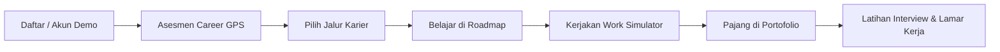

# PathForge — Career GPS & Work Simulator

PathForge adalah aplikasi web untuk membantu **mahasiswa, fresh graduate, dan career switcher** di Indonesia menemukan jalur karier teknologi yang cocok, belajar dengan roadmap terarah, berlatih lewat simulasi kerja nyata, lalu membangun portofolio yang siap ditunjukkan ke rekruter.

> Proyek ini dibuat untuk tugas kuliah dan demo portofolio.

---

## Fitur yang Sudah Ada

| Fitur | Rute | Keterangan |
| :--- | :--- | :--- |
| **Landing Page** | `/` | Halaman perkenalan, daftar jalur karier, dan tombol daftar/masuk |
| **Register, Login & Akun Demo** | `/register`, `/login` | Daftar akun, masuk, lupa kata sandi (OTP 6 digit), dan masuk 1-klik dengan akun demo |
| **Asesmen Career GPS** | `/onboarding` | 8 pertanyaan minat & gaya kerja → rekomendasi jalur karier dengan skor kecocokan |
| **Dashboard** | `/dashboard` | Skor kesiapan kerja, misi pengguna baru (*Starter Quests*), rekomendasi langkah berikutnya, dan aktivitas terakhir |
| **Jalur Karier & Perbandingan** | `/careers`, `/careers/[id]`, `/careers/compare` | 6 jalur karier lengkap dengan gaji (Rupiah), skill, dan prospek; bisa dibandingkan hingga 3 sekaligus |
| **Roadmap Belajar** | `/roadmap` | Checklist modul per fase, perencana jadwal belajar, catatan pribadi per modul, dan sertifikat saat selesai |
| **Work Simulator** | `/simulator` | 12 tugas kerja nyata dari studi kasus perusahaan Indonesia, dinilai otomatis dengan rubrik + feedback |
| **Kuis Kilat Harian** | Dashboard | 3 soal singkat per hari (+25 XP) untuk menjaga streak belajar |
| **Portofolio & CV Publik** | `/portfolio`, `/p/[username]` | Pilih hasil simulasi terbaik, edit profil, dan cetak CV ke PDF |
| **CV Skill Scanner** | `/scanner` | Tempel isi CV → deteksi skill yang sudah dikuasai dan tandai modul roadmap otomatis |
| **Lowongan Kerja** | `/jobs` | 12 lowongan dengan persentase kecocokan dan lamar 1-klik |
| **Latihan Interview** | `/interview` | Latihan wawancara metode STAR dengan timer dan contoh jawaban |
| **Kalkulator Gaji (THP)** | `/calculator` | Hitung gaji bersih setelah BPJS & PPh 21, alokasi 50/30/20, dan proyeksi 5 tahun |
| **Papan Peringkat (Leaderboard)** | `/leaderboard` | Peringkat pembelajar berdasarkan Total XP, Level, Kesiapan Kerja, dan Streak |
| **Progres & Lencana** | `/progress` | XP, level, streak, dan badge yang terbuka |
| **Pengaturan & Backup Data** | `/settings` | Ubah profil, kata sandi, unduh/pulihkan backup `.json`, reset progres, dan hapus akun |
| **Command Palette & Tema** | `Ctrl + K` | Navigasi cepat ke semua halaman, plus mode terang/gelap |

---

## Cara Kerja



1. **Daftar atau masuk** — pengguna membuat akun atau langsung mencoba lewat akun demo.
2. **Asesmen** — jawaban asesmen dihitung menjadi skor kecocokan untuk setiap jalur karier.
3. **Belajar** — pengguna menyelesaikan modul di roadmap. Setiap modul memberi XP dan menaikkan skor kesiapan kerja.
4. **Simulasi kerja** — jawaban tugas dinilai otomatis berdasarkan rubrik, lalu diberi skor 0–100 dan feedback.
5. **Portofolio** — hasil simulasi terbaik bisa dipajang dan dicetak sebagai CV.
6. **Siap kerja** — pengguna berlatih interview, menghitung ekspektasi gaji, dan melamar lowongan yang cocok.

### Arsitektur Singkat

- **Frontend:** Next.js 16 (App Router), React 19, TypeScript, Tailwind CSS, shadcn/ui.
- **Backend API Routes (`app/api/...`):**
  - `POST /api/auth/register`, `POST /api/auth/login`, `POST /api/auth/demo`, `POST /api/auth/logout`, `GET /api/auth/me`, `PATCH & DELETE /api/auth/account`, `POST /api/auth/forgot-password` — autentikasi, sesi cookie, akun demo, dan pemulihan kata sandi dengan OTP 6 digit.
  - `GET & POST /api/assessment` — kuis asesmen Career GPS dan kalkulasi skor kecocokan 6 jalur karier di server.
  - `GET & PATCH /api/careers` — katalog jalur karier, metrik kesiapan user, dan pergantian jalur karier aktif di server.
  - `GET & POST /api/roadmap` — kurikulum 3 fase, *toggle* penyelesaian modul (+XP), catatan belajar per modul, dan penyimpanan *Smart Study Plan*.
  - `GET & PATCH /api/simulator` & `POST /api/simulator/submit` — katalog Work Simulator, *autosave draft*, *pin* proyek unggulan portofolio, serta penilaian rubrik otomatis (skor 0–100 + *feedback*) di server.
  - `GET & POST /api/daily-quiz` — soal Tantangan Kuis Kilat Harian, penilaian jawaban di server (+25 XP), dan pencatatan *streak* harian.
  - `POST /api/scanner/analyze` — analisis teks CV untuk deteksi *skill gap* serta sinkronisasi modul Roadmap di server.
  - `POST /api/calculator` — kalkulasi *Take Home Pay* (THP), potongan BPJS Kesehatan/TK, PPh 21, alokasi 50/30/20, dan proyeksi gaji 5 tahun di server.
  - `GET & POST /api/jobs` — daftar lowongan kerja dengan kalkulasi kecocokan (*job match*) dan pencatatan lamaran kerja di server.
  - `GET & POST /api/interview` — daftar pertanyaan wawancara metode STAR dan penyimpanan riwayat latihan interview di server.
  - `GET /api/progress` — kalkulasi terpusat untuk Total XP, Level, Streak, Skor Kesiapan Kerja, Level Skill, Lencana (*Badges*), dan kelayakan Sertifikat.
  - `GET /api/public/portfolio/[username]` — mengambil data portofolio publik langsung dari server berdasarkan slug nama pengguna.
  - `GET & POST /api/user/backup` & `GET & PUT /api/user/data` — ekspor/impor cadangan progres `.json` dan sinkronisasi penuh data pengguna.
  - `GET /api/leaderboard` — peringkat talenta dan pembelajar berdasarkan XP, Level, dan kesiapan kerja.
- **Keamanan:** kata sandi di-hash dengan `scrypt` (`timingSafeEqual`), sesi disimpan di cookie `HttpOnly`, dan endpoint autentikasi dilindungi *Sliding Window Rate Limiter* (`lib/server/rate-limit.ts`).
- **Penyimpanan:** progres disimpan di browser (`localStorage`) dan disinkronkan ke database file sementara di server (`lib/server/db.ts`).

---

## Menjalankan Secara Lokal

```powershell
npx --yes pnpm@10.28.0 install
npx --yes pnpm@10.28.0 run dev
```

Buka `http://localhost:3000`, lalu klik **"Coba dengan akun demo"** di halaman login.

**Akun demo:** `demo@pathforge.id` / `demo1234`

---

## Batasan

- Data di server bersifat **sementara**. Saat di-deploy ke Vercel, akun baru dan sesi login bisa ter-reset ketika server dimulai ulang.
- Progres tetap tersimpan di browser yang sama, dan akun demo selalu tersedia.
- Gunakan akun demo atau akun uji coba saja, jangan data pribadi asli.
