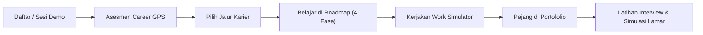

# PathForge — Career GPS & Work Simulator

PathForge adalah aplikasi web untuk membantu **mahasiswa, fresh graduate, dan career switcher** di Indonesia menemukan jalur karier yang cocok (baik **IT maupun Non-IT**), belajar dengan roadmap terarah, berlatih lewat simulasi kerja nyata, lalu membangun portofolio yang siap ditunjukkan ke rekruter.

> Proyek ini dibuat untuk tugas kuliah dan demo portofolio.

---

## Fitur yang Sudah Ada

| Fitur | Rute | Keterangan |
| :--- | :--- | :--- |
| **Landing Page** | `/` | Halaman perkenalan, daftar 10 jalur karier (IT & Non-IT), dan tombol daftar/masuk |
| **Register, Login & Sesi Demo** | `/register`, `/login` | Daftar akun, masuk, dan masuk 1-klik dengan sesi demo terisolasi per pengunjung |
| **Asesmen Career GPS** | `/onboarding` | 8 pertanyaan minat & gaya kerja → rekomendasi 10 jalur karier (IT & Non-IT) dengan skor kecocokan |
| **Dashboard** | `/dashboard` | Skor kesiapan kerja, misi pengguna baru (*Starter Quests*), rekomendasi langkah berikutnya, dan aktivitas terakhir |
| **Jalur Karier & Perbandingan** | `/careers`, `/careers/[id]`, `/careers/compare` | 10 jalur karier (Web, Mobile, UI/UX, Data, QA, Business Analyst, Digital Marketing, HR, Finance, Project Manager) lengkap dengan gaji Rupiah; bisa dibandingkan 2 hingga 3 sekaligus |
| **Roadmap Belajar** | `/roadmap` | Kurikulum 4 fase per karier, checklist modul, perencana jadwal belajar, catatan pribadi per modul, dan sertifikat saat 100% modul selesai |
| **Work Simulator** | `/simulator` | 16 tugas kerja nyata dari studi kasus perusahaan Indonesia (IT & Non-IT), dinilai dengan rubrik heuristik otomatis + feedback |
| **Kuis Kilat Harian** | Dashboard | 3 soal singkat per hari (hingga +25 XP pada pengerjaan pertama hari tersebut) untuk menjaga streak belajar |
| **Portofolio & CV Publik** | `/portfolio`, `/p/[username]` | Pilih hasil simulasi terbaik, atur privasi publik/privat di server, edit profil, dan cetak CV ke PDF |
| **CV Skill Scanner** | `/scanner` | Tempel isi CV (minimal 10 karakter) → deteksi skill (IT & Non-IT) yang sudah dikuasai dan tandai modul roadmap otomatis |
| **Simulasi Lowongan Kerja** | `/jobs` | 12 lowongan simulasi (IT & Non-IT) dengan persentase kecocokan dan simulasi lamar cepat 1-klik |
| **Latihan Interview** | `/interview` | 16 pertanyaan wawancara metode STAR dengan timer dan contoh jawaban |
| **Kalkulator Gaji (THP)** | `/calculator` | Estimasi ilustratif gaji bersih setelah BPJS & PPh 21 sederhana, alokasi 50/30/20, dan proyeksi 5 tahun |
| **Papan Peringkat (Leaderboard)** | `/leaderboard` | Peringkat pembelajar berdasarkan Total XP, Level, Kesiapan Kerja, dan Streak dengan kontrol visibilitas opt-in |
| **Progres & Lencana** | `/progress` | XP, level, streak, 8 badge prestasi, dan sertifikat kelulusan (terbuka saat 100% modul roadmap tuntas) |
| **Pengaturan & Backup Data** | `/settings` | Ubah profil, privasi portofolio & leaderboard, kata sandi, unduh/pulihkan backup `.json` tervalidasi, reset progres, dan hapus akun |
| **Command Palette & Tema** | `Ctrl + K` | Navigasi cepat ke semua halaman, plus mode terang/gelap |

---

## Cara Kerja



1. **Daftar atau masuk** — pengguna membuat akun atau langsung mencoba lewat sesi akun demo terisolasi.
2. **Asesmen** — 8 jawaban asesmen divalidasi dan dihitung menjadi skor kecocokan untuk 10 jalur karier.
3. **Belajar** — pengguna menyelesaikan modul di roadmap (4 fase per karier). Setiap modul memberi XP dan menaikkan skor kesiapan kerja.
4. **Simulasi kerja** — jawaban tugas dinilai secara heuristik berdasarkan rubrik, lalu diberi skor 0–100 dan feedback.
5. **Portofolio** — hasil simulasi terbaik bisa dipajang, diatur visibilitas publik/privat-nya, dan dicetak sebagai CV.
6. **Siap kerja** — pengguna berlatih interview, menghitung estimasi ilustratif gaji, dan menyimulasikan lamaran lowongan yang cocok.

### Arsitektur Singkat

- **Frontend:** Next.js 16 (App Router), React 19, TypeScript, Tailwind CSS, shadcn/ui.
- **Backend API Routes (`app/api/...`):**
  - `POST /api/auth/register`, `POST /api/auth/login`, `POST /api/auth/demo`, `POST /api/auth/logout`, `GET /api/auth/me`, `PATCH & DELETE /api/auth/account`, `POST /api/auth/forgot-password` — autentikasi, sesi cookie, isolasi sesi demo per pengunjung, penghapusan akun bersih (sesi + progres + rekaman OTP), serta kebijakan pemulihan kata sandi yang menonaktifkan pemulihan tanpa kanal email terverifikasi.
  - `GET & POST /api/assessment` — kuis asesmen Career GPS dengan validasi lengkap 8 jawaban dan kalkulasi skor kecocokan 10 jalur karier di server.
  - `GET & PATCH /api/careers` — katalog 10 jalur karier, metrik kesiapan user, dan pergantian jalur karier aktif di server.
  - `GET & POST /api/roadmap` — kurikulum 4 fase per karier, *toggle* penyelesaian modul (+XP), catatan belajar per modul, dan penyimpanan *Smart Study Plan*.
  - `GET & PATCH /api/simulator` & `POST /api/simulator/submit` — katalog 16 Work Simulator, *debounced autosave draft*, *pin* proyek unggulan portofolio, serta penilaian rubrik heuristik otomatis (skor 0–100 + *feedback*) di server.
  - `GET & POST /api/daily-quiz` — soal Tantangan Kuis Kilat Harian (tanpa membocorkan kunci jawaban pada `GET`), penilaian jawaban di server (hingga +25 XP pada pengerjaan pertama per hari), dan pencatatan *streak* harian.
  - `POST /api/scanner/analyze` — analisis teks CV untuk deteksi *skill gap* serta sinkronisasi modul Roadmap di server.
  - `POST /api/calculator` — kalkulasi estimasi ilustratif *Take Home Pay* (THP), potongan BPJS Kesehatan/TK, PPh 21 sederhana, alokasi 50/30/20, dan proyeksi gaji 5 tahun di server.
  - `GET & POST /api/jobs` — daftar 12 lowongan kerja simulasi dengan kalkulasi kecocokan (*job match*) dan pencatatan simulasi lamaran di server.
  - `GET & POST /api/interview` — daftar 16 pertanyaan wawancara metode STAR dan penyimpanan riwayat latihan interview di server.
  - `GET /api/progress` — kalkulasi terpusat untuk Total XP (modul, simulasi, kuis, interview, lamaran), Level, Streak, Skor Kesiapan Kerja, Level Skill, Lencana (*Badges*), dan kelayakan Sertifikat (100% modul selesai).
  - `GET /api/public/portfolio/[username]` — mengambil data portofolio publik dari server dengan penegakan privasi `publicPortfolio` (`403 PRIVATE` untuk non-pemilik jika privat, `404 NOT_FOUND` jika tidak ditemukan).
  - `GET & POST /api/user/backup` & `GET & PUT /api/user/data` — ekspor/impor cadangan progres `.json` dengan validasi skema ketat dan sinkronisasi penuh data pengguna.
  - `GET /api/leaderboard` — peringkat talenta berdasarkan XP, Level, dan kesiapan kerja dengan penghormatan privasi opt-in (`showOnLeaderboard`).
- **Keamanan:** kata sandi di-hash dengan `scrypt` (`timingSafeEqual`), sesi disimpan di cookie `HttpOnly`, dan endpoint autentikasi dilindungi *Sliding Window Rate Limiter* (`lib/server/rate-limit.ts`).
- **Penyimpanan:** progres disimpan di browser (`localStorage`) dan disinkronkan ke database file JSON lokal di server (`lib/server/db.ts`).

---

## Menjalankan Secara Lokal

```powershell
npx --yes pnpm@10.28.0 install
npx --yes pnpm@10.28.0 run dev
```

Buka `http://localhost:3000`, lalu klik **"Coba dengan akun demo"** di halaman login.

---

## Batasan & Catatan Deployment Serverless (Vercel)

- **Penyimpanan Ephemeral pada Serverless:** Di lingkungan lokal (`next dev` / `next start`), data disimpan secara persisten di `.data/pathforge-db.json`. Namun saat di-deploy ke Vercel tanpa layanan database eksternal (seperti Postgres/KV), penyimpanan server menggunakan `/tmp/pathforge-db.json` yang bersifat **sementara (ephemeral per-instance)** — akun dan sesi server dapat ter-reset saat *cold start* atau perpindahan *serverless instance*.
- **Mitigasi untuk Demo:** Tombol **"Coba dengan akun demo"** membuat sesi demo terisolasi per pengunjung dan otomatis memulihkan sesi apabila instance serverless ter-reset. Pengguna juga dapat mengunduh dan memulihkan file cadangan (`.json`) melalui menu **Pengaturan**.
- Gunakan akun demo atau akun uji coba saja, jangan memasukkan data pribadi sensitif.
